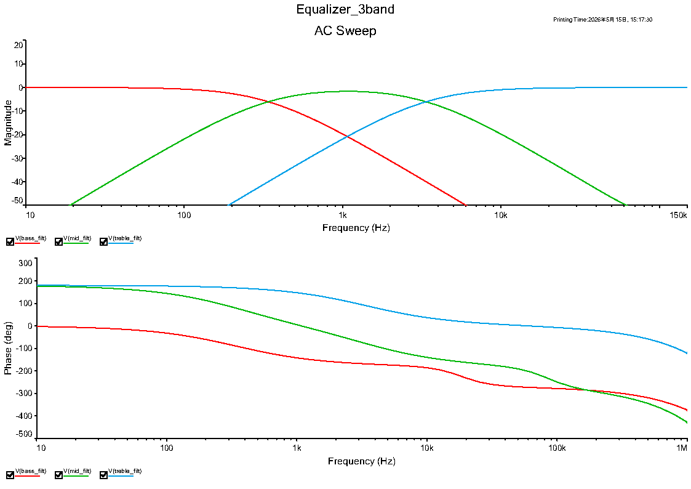
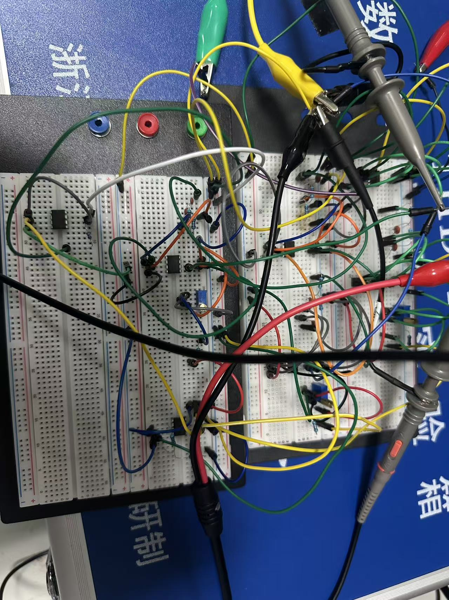

# Analog Graphic Equalizer

[简体中文](README.zh-CN.md)

This project designs a seven-band analog graphic equalizer in Multisim and builds a simplified three-band prototype on a breadboard. Each branch filters part of the audio spectrum. On the physical prototype, a potentiometer sets the level of each filtered signal before the inverting summer and output buffer.

**What worked.** The saved Multisim sweep shows separate bass, midrange and treble responses. A bench oscilloscope capture shows two channels oscillating near 1 kHz when testing the midrange branch. The three-band ideal-op-amp reference netlist also produced a 401-point AC sweep in LTspice.

| Material | Link |
| --- | --- |
| Three-band simulation | [Multisim design](Simu_File/Equalizer_3band.ms14), [AC sweep](Img/3Band_AC_SWEEP/3Band_AC_SWEEP_New.png) |
| Seven-band simulation | [Multisim design](Simu_File/Equalizer_7band.ms14), [AC sweep](Img/7Band_AC_SWEEP/7Band_AC_SWEEP.png) |
| Physical three-band build | [Breadboard](docs/three-band-breadboard.jpg), [near-1 kHz scope capture](docs/mid-1khz-scope.jpg) |
| Separate three-band reference | [Ideal SPICE model](3band_equalizer_multisim_netlist.cir), [reference schematic](3band_equalizer_reference_schematic.svg), [reference parts list](3band_equalizer_parts_list.csv) |

[Build stages, frequency bands and verification](docs/simulation.md)
