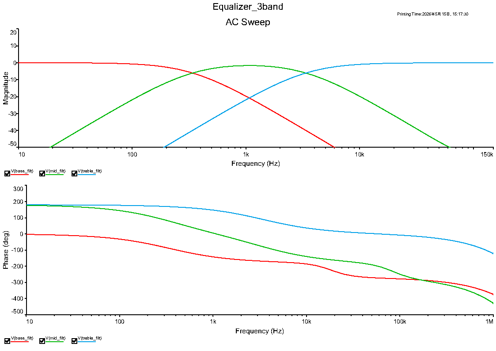
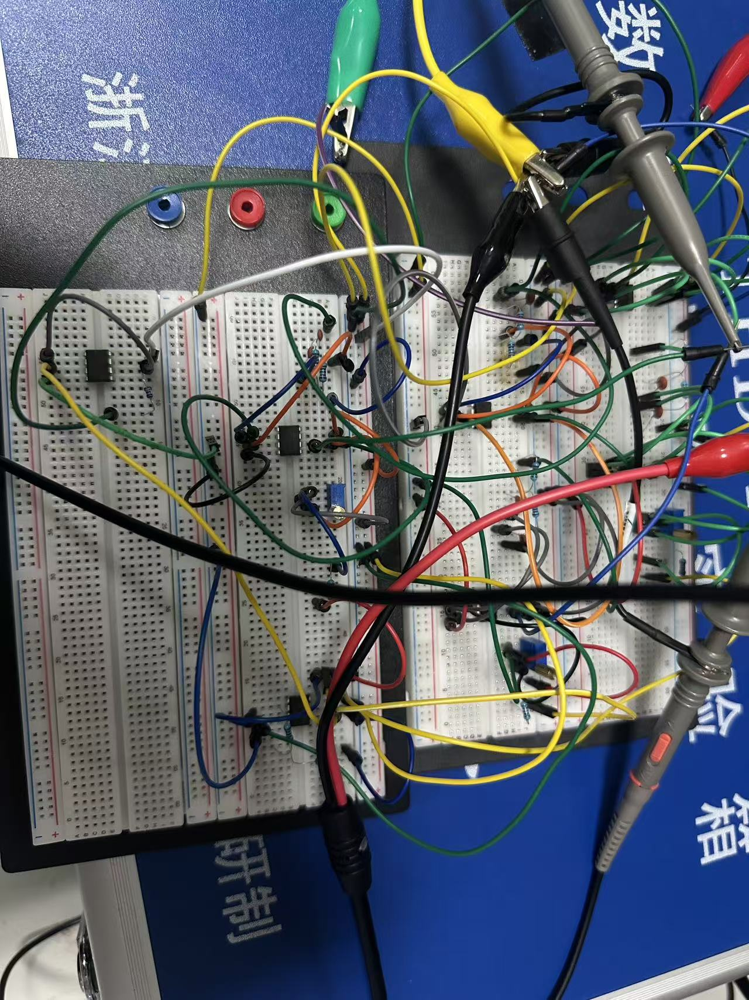

# 模拟图示均衡器

[English](README.md)

项目先在 Multisim 中设计七段模拟均衡器，再在面包板上搭建简化的三段原型。各支路分离不同频段。在实物原型上，电位器分别调节各滤波支路的电平，随后由反相求和级合成并经过输出缓冲。

**实际效果。** 原始 Multisim 扫频图显示了低、中、高频支路的分离。中频支路测试的示波器截图中，两路波形都接近 1 kHz。三段理想运放参考网表还用 LTspice 完成了 401 点交流扫频。

| 内容 | 文件 |
| --- | --- |
| 三段仿真 | [Multisim 工程](Simu_File/Equalizer_3band.ms14)、[交流扫频](Img/3Band_AC_SWEEP/3Band_AC_SWEEP_New.png) |
| 七段仿真 | [Multisim 工程](Simu_File/Equalizer_7band.ms14)、[交流扫频](Img/7Band_AC_SWEEP/7Band_AC_SWEEP.png) |
| 三段实物 | [面包板照片](docs/three-band-breadboard.jpg)、[近 1 kHz 示波器截图](docs/mid-1khz-scope.jpg) |
| 独立三段参考设计 | [理想 SPICE 网表](3band_equalizer_multisim_netlist.cir)、[参考原理图](3band_equalizer_reference_schematic.svg)、[参考元件清单](3band_equalizer_parts_list.csv) |

[电路搭建、频段与验证说明](docs/simulation.zh-CN.md)
