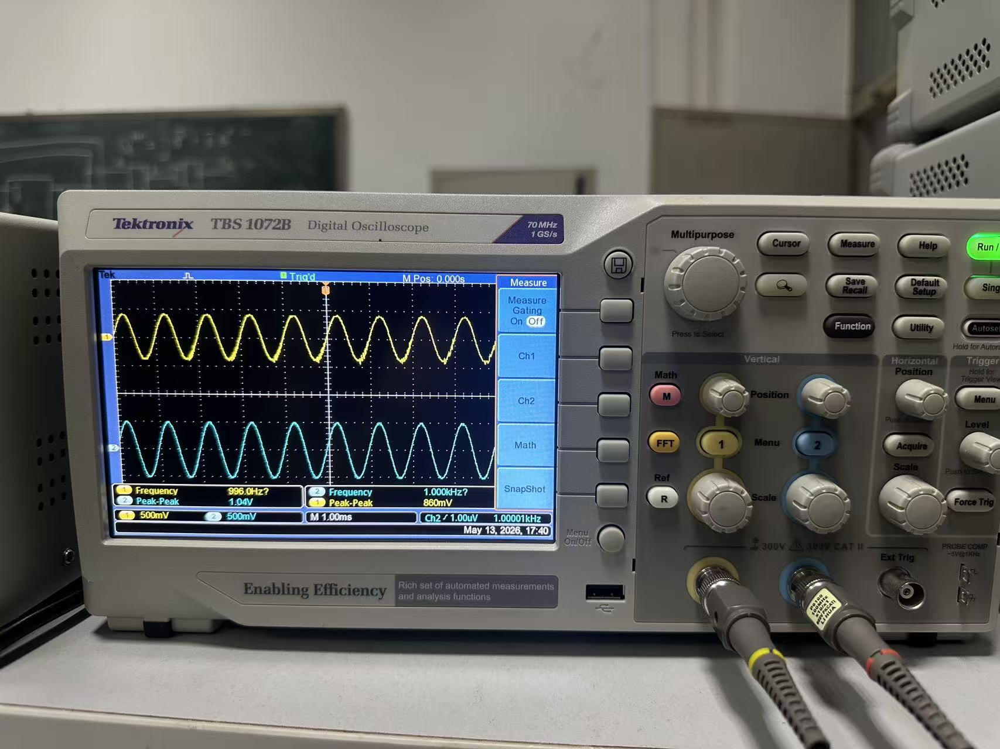

# Circuit Design and Verification

[简体中文](simulation.zh-CN.md) · [Project home](../README.md)

## Simulation and hardware variants

| Variant | What it demonstrates |
| --- | --- |
| Seven-band Multisim | Cascaded active RC branches divided at 100 Hz, 250 Hz, 630 Hz, 1.6 kHz, 4 kHz and 10 kHz. |
| Three-band Multisim | Bass below roughly 340 Hz, a mid band between roughly 340 Hz and 3.4 kHz, and treble above roughly 3.4 kHz. |
| Three-band breadboard | Seven LM741/LM741CN op-amps on ±15 V rails. Input buffer U1, bass U2, mid U3/U4, treble U5, summer U6 and output buffer U7. |
| SPICE reference circuit | Separate ideal controlled-source op-amp model. Its part list describes that reference, not the seven-op-amp physical implementation. |

The course report uses 10 kΩ with 47 nF for the lower design corner and 10 kΩ with 4.7 nF for the upper. After each branch, a 50 kΩ potentiometer sends a variable fraction of the filtered signal into a 10 kΩ summing resistor. The feedback resistor on U6 is 10 kΩ.

## How to check it

1. Open the .ms14 model in Multisim and apply a 1 V AC input. Use a decade sweep from 10 Hz to 100 kHz with 100 points per decade. Plot the individual branches and AUDIO_OUT separately.
2. Check bass near 100 Hz, mid near 1 kHz and treble near 10 kHz. In the physical build, use the oscilloscope to compare branch output and recombined output while adjusting the corresponding potentiometer. Reduce the input if the waveform clips.
3. For a simulator-independent check, open the [reference netlist](../3band_equalizer_multisim_netlist.cir) in LTspice and run its AC directive. A 401-point sweep was generated. The spare ideal-model rail nodes may emit warnings.

The original capture displays approximately 996 Hz and 1.000 kHz with 0.86 Vpp and 1.04 Vpp on the two channels. The image is one bench observation. Component tolerance, bandwidth and complete response measurements are outside that capture.
