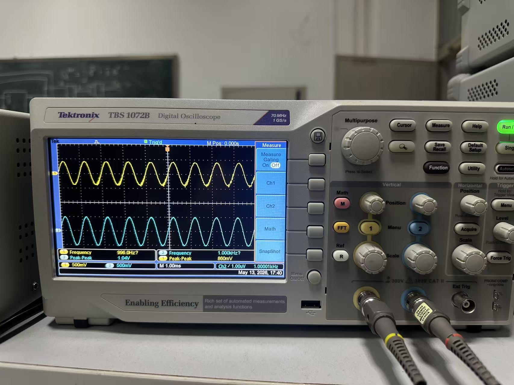

# 电路设计与验证

[English](simulation.md) · [项目首页](../README.zh-CN.md)

## 仿真与实物版本

| 版本 | 设计内容 |
| --- | --- |
| 七段 Multisim | 并联有源 RC 支路，分频点为 100 Hz、250 Hz、630 Hz、1.6 kHz、4 kHz、10 kHz。 |
| 三段 Multisim | 约 340 Hz 以下为低频，约 340 Hz 至 3.4 kHz 为中频，约 3.4 kHz 以上为高频。 |
| 三段面包板 | 七片 LM741/LM741CN 运放，±15 V 供电。U1 输入缓冲，U2 低频，U3/U4 中频，U5 高频，U6 求和，U7 输出缓冲。 |
| 独立 SPICE 参考 | 用受控源实现理想运放。配套元件清单对应此参考设计，面包板版本以课程报告中的七运放电路为准。 |

课程报告使用 10 kΩ 与 47 nF 设置低分频点，10 kΩ 与 4.7 nF 设置高分频点。每条滤波支路后的 50 kΩ 电位器将可调比例的信号送入 10 kΩ 输入电阻。U6 的反馈电阻为 10 kΩ。

## 验证步骤

1. 在 Multisim 中打开 .ms14 工程，输入源设为 1 V AC。按十倍频程从 10 Hz 扫至 100 kHz，每十倍频程 100 点，分别观察各支路与 AUDIO_OUT。
2. 在约 100 Hz、1 kHz 和 10 kHz 依次检查低、中、高频。实物可调节相应电位器，并用示波器比较支路输出和合成输出。若出现削顶，降低输入幅度。
3. 用 LTspice 打开[参考网表](../3band_equalizer_multisim_netlist.cir)，运行其交流分析指令。已成功生成 401 点扫频；理想模型中未参与运算的电源节点可能提示警告。

原始截图显示两路频率约 996 Hz 和 1.000 kHz，峰峰值约 0.86 V 和 1.04 V。这是一次台架记录，不能据此推导器件容差、带宽或完整频响。
